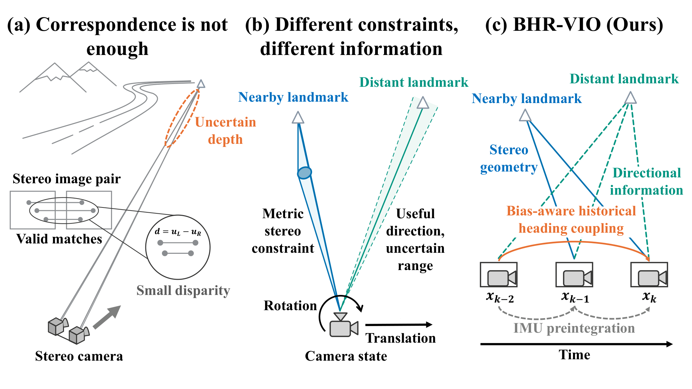
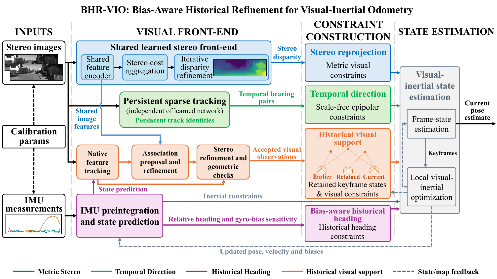
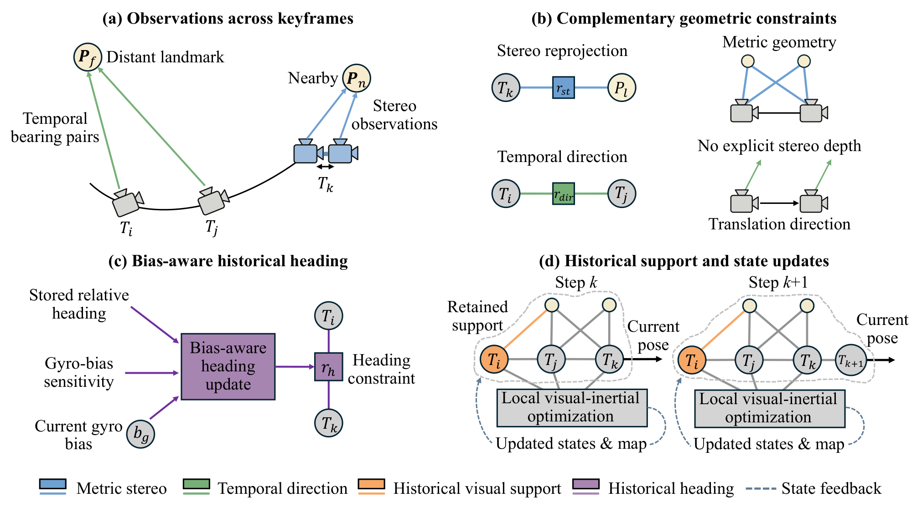
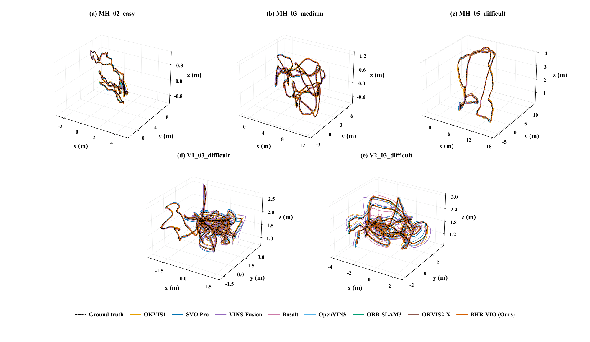
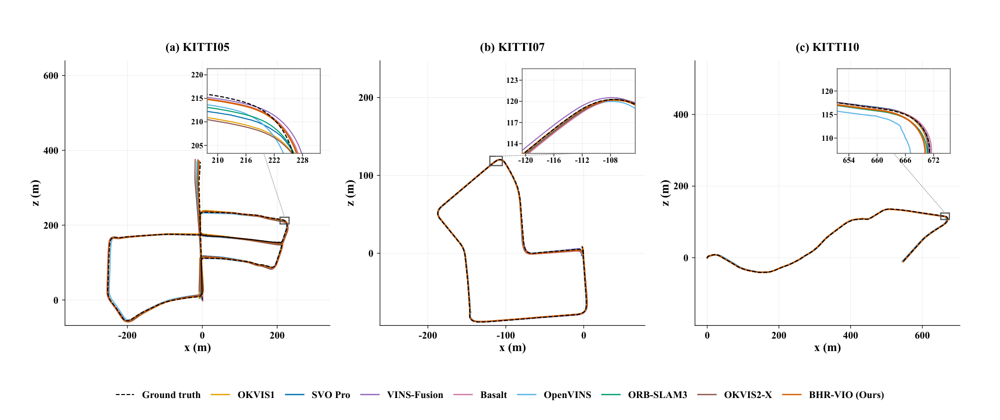
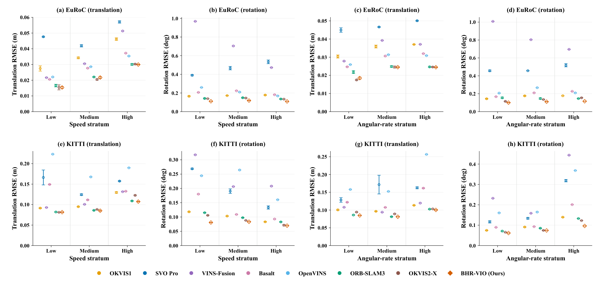

<h1 align="center">BHR-VIO: Bias-Aware Historical Refinement for Visual-Inertial Odometry</h1>

<p align="center">
Mingxian Fu · Shuai Zhao · Yilan Zhou · Tengchao Huang<br>
Zhejiang University · Jiangxi Qiushi Academy of Advanced Study
</p>

<p align="center">
<a href="#abstract">Abstract</a> · <a href="#method-overview">Method</a> ·
<a href="#results">Results</a> · <a href="#installation-ubuntu-2204-or-ubuntu-2204-under-wsl2">Installation</a> ·
<a href="#input-sequences">Run</a> · <a href="#weights-and-licenses">Licenses</a>
</p>

Research implementation of **BHR-VIO**, a stereo visual-inertial odometry framework
combining learned observation refinement, geometric motion constraints and
bias-aware historical refinement. The manuscript is in preparation.

## Abstract

Accurate visual-inertial odometry requires image observations to constrain motion even when scene depth is uncertain. A valid correspondence can retain useful directional information while providing weak metric translation constraints, and its interpretation can change as historical poses and inertial biases are refined. We propose Bias-Aware Historical Refinement for Visual-Inertial Odometry (BHR-VIO), an architecture that couples observation refinement with historical state updates. A shared stereo frontend supplies depth and temporal association proposals. Source-aware observation likelihoods retain alternative image explanations, while depth-independent direction constraints preserve motion information from persistent tracks. Historical visual support and bias-aware heading refinement connect these observations to the evolving visual-inertial state. Evaluation against seven stereo-inertial baselines on five EuRoC and three KITTI sequences gives average absolute trajectory errors of 0.0364 m and 1.032 m, respectively, reducing the best baseline averages by 9.1% and 17.0%. Average rotational errors decrease by 19.6% on EuRoC and 22.6% on KITTI relative to the strongest baseline for each metric. Motion-stratified comparisons show lower rotational error across all evaluated speed and angular-rate groups. Component experiments identify observation refinement and bias-aware historical heading as complementary contributors to trajectory accuracy. These results support fusion that preserves the distinct geometric information in current observations and revises its historical context during state estimation.

## Method overview

**Motivation.** Valid image correspondences can preserve direction information
while providing weak metric translation constraints. BHR-VIO connects their
geometric interpretation to historical pose and inertial-bias updates.



**Architecture.** Shared learned features support stereo refinement and temporal
association. The native visual-inertial estimator combines the resulting
observations with persistent tracks and bias-aware historical information.



**Mechanism.** Observation refinement and historical state refinement operate
within the same visual-inertial estimation pipeline.



## Results

The manuscript compares BHR-VIO with seven stereo-inertial baselines on five
EuRoC and three KITTI evaluation sequences. Dataset averages weight sequences
equally; the accuracy tables use three runs per method.

| Evaluation | BHR-VIO average ATE | Reduction from the lowest baseline average |
| :--- | ---: | ---: |
| EuRoC (5 sequences) | 0.0364 m | 9.1% |
| KITTI (3 sequences) | 1.032 m | 17.0% |

**EuRoC trajectories.** Estimated and reference trajectories after rigid alignment.



**KITTI trajectories.** Driving trajectories and local views around turns.



**Motion-stratified accuracy.** Translation and rotation errors across speed and
angular-rate strata use common approximately one-second motion intervals.
BHR-VIO has lower rotational error across all evaluated strata.



Vector PDFs for all displayed figures are available in [assets](assets).
Figures reproduce the manuscript results without changing trajectories or scores.

## Contents

- `native/ORB_SLAM3`: BHR-VIO native estimator, including its modified tracking,
  observation likelihood, direction and historical-state operators.
- `native/Pangolin`: the source version used by the native build.
- `frontend/network`: frozen upstream stereo-network code and attribution.
- `runtime`: image/feature bridge, sparse track support and native replay.
- `weights/23-36-37`: serialized pretrained model and its configuration.
- `scripts`: build and single-sequence entrypoints.
- `evaluation/frozen_score.py`: the original scoring function, with explicit
  inputs for timestamps, shared evaluation support, reference positions and
  camera/IMU transform. Evaluation references are never passed to inference.
- `patches/paper_backend.patch`: exact native-source difference restoring the
  original paper-table backend from the later deterministic backend.
- `provenance`: source hashes, version identities and measured source environment.

## Version identity

The default native source is extracted from frozen image config digest
`2f19402b749f2295fb391b1f573df24c1baa50a3350e735672ad53fed116ad97`,
the deterministic component/efficiency implementation. It includes the
repeatability repairs and explicit component switches. The earlier paper-table
native snapshot is
`3e1becac44c2d8523ff7d14f0e47da1d624bc435bd32532a6dd0ba949a8acfa0`.
These are distinct builds, not byte-identical aliases. The exact per-file source
hashes and reverse patch are included so the native implementation history is
recoverable. Applying the patch restores native source only; it does not by itself
restore every historical frontend environment or execution schedule.

The release changes only entrypoint paths and build portability. Native model
source, frontend inference operations, weights, factors and default estimator
switches have not been optimized or retuned for this package. C++11 is enforced
consistently across ORB-SLAM3, g2o and DBoW2 to avoid the cross-standard Eigen
aligned-allocation mismatch diagnosed during the desktop deployment. AVX2 build
flags replace host-specific AVX-512 compilation. Legacy unused example targets
are omitted at build time, not estimation modules.

## Installation (Ubuntu 22.04 or Ubuntu 22.04 under WSL2)

Requirements: NVIDIA GPU and working driver, Python 3.11, Docker Engine, and
approximately 24 GB system memory available to the native container. The frontend
was measured on A100 80 GB and RTX 4070 Ti 12 GB GPUs. The native container is CPU
only; CUDA inference runs in the host Python environment.

```bash
python3.11 -m venv .venv
source .venv/bin/activate
python -m pip install --upgrade pip
python -m pip install torch==2.11.0 torchvision==0.26.0 --index-url https://download.pytorch.org/whl/cu128
python -m pip install -r requirements.txt
python scripts/verify_package.py
python scripts/preflight.py
python scripts/build_image.py
```

`build_image.py` records the newly built local image identity in
`runtime/built_image.json`. That generated file must not be committed. A local
rebuild has a new image identity; the original provenance remains unchanged.
Docker build needs network access for Ubuntu packages. Running inference does not
require Docker GPU access. Run Docker as a user permitted to access its daemon.

## Input sequences

Download EuRoC and KITTI from their dataset providers; no dataset is bundled.
Each input directory must have the following EuRoC-style physical-sensor layout:

```text
mav0/
  cam0/data.csv       # timestamp_ns,filename
  cam0/data/*.png
  cam1/data.csv       # timestamp_ns,filename
  cam1/data/*.png
  imu0/data.csv       # timestamp_ns,wx,wy,wz,ax,ay,az
```

For EuRoC, use the original `mav0` directory. For KITTI, associate the raw OXTS IMU
stream and physical stereo images with the corresponding odometry sequence and
export this same layout. Use raw timestamps, angular velocity in rad/s and
acceleration in m/s^2; do not synthesize IMU from ground truth or supply already
rectified images with a raw-camera calibration. KITTI odometry camera files alone
are not a complete inertial input. This archive does not include a new automatic
KITTI raw-to-odometry converter. The original frozen physical calibrations for
EuRoC 11 and KITTI 10 applicable sequences are in `runtime/calibration_manifest.json`.
The inference entrypoint synchronizes left/right timestamp identities and applies
the existing KITTI time shift; it does not use reference poses.

```bash
python scripts/run_sequence.py --dataset euroc --sequence MH_02_easy \
  --data /path/to/MH_02_easy/mav0 --output /path/to/new_run --gpu 0 --seed 44
python scripts/run_sequence.py --dataset kitti --sequence 05 \
  --data /path/to/prepared_kitti05/mav0 --output /path/to/new_kitti05_run --gpu 0 --seed 44
```

The output contains `native/CameraTrajectory.txt`, native logs and a command
manifest, plus learned-frontend logs. Existing output directories are rejected.
`run_time.json` is diagnostic wall time, not the paper's production timing harness.

## Evaluation

`evaluation/frozen_score.py:score(z,t,c,T)` takes an N×8 trajectory array
(timestamp,xyz,qx,qy,qz,qw), times in the same coordinate as evaluation support,
a support dictionary and the physical calibration matrix. `c` contains `ts`,
`ids`, `gpos` and `segments` (empty for EuRoC); KITTI additionally uses the original evaluation segment indices,
lengths and reference relative displacements. Consult the function for exact key
names. Reference data and common-support selections must be generated from the
licensed datasets using the manuscript evaluation protocol. This package does not
embed reference trajectories or frozen numerical results.

## Weights and licenses

The included weight file has 17,654,857 learned parameters and is an upstream
pretrained checkpoint, not a newly trained BHR-VIO network. Its SHA-256 is
`af0658f289ec840b292645f8d5538978f06e8cabaa1fd31e84acc91af268e990`.
Keep the associated source files when loading this serialized PyTorch object.
Load only trusted checkpoints. See `THIRD_PARTY_NOTICES.md` for component licenses;
the NVIDIA network/weights retain their non-commercial research terms, and the
native code retains its GPL notices.

## Publishing

Unpack and commit the repository contents, rather than committing the ZIP itself.
The weights may be stored using Git LFS or a GitHub Release asset. Keep their hash
and original license with them. `.gitignore` excludes datasets, generated binaries
and runtime outputs; do not add local SSH helpers or private environment files.

## Verification scope

The archive manifest verifies file integrity; frozen implementation hashes and
weight identity are recorded separately. Python entrypoints receive syntax checks
and the native sources receive a build check. A new complete eight-sequence VIO
campaign is not part of source packaging; do not interpret a successful build as
cross-device trajectory equivalence. The source-server and desktop experiments
remain the evidence for the manuscript's accuracy and timing, respectively.


## Acknowledgments

We thank the authors of ORB-SLAM3, Fast-FoundationStereo / FoundationStereo,
Pangolin, DBoW2, g2o and Sophus for making their implementations available.
Component attribution and license files are listed in
[THIRD_PARTY_NOTICES.md](THIRD_PARTY_NOTICES.md).

This work was supported by the Nanchang Municipal Science and Technology Major Project (Sub-project No. 202601zdzx007), entitled “AI-Based High-Efficiency and High-Precision Multi-Group Active Alignment Equipment and Industrialization.”
